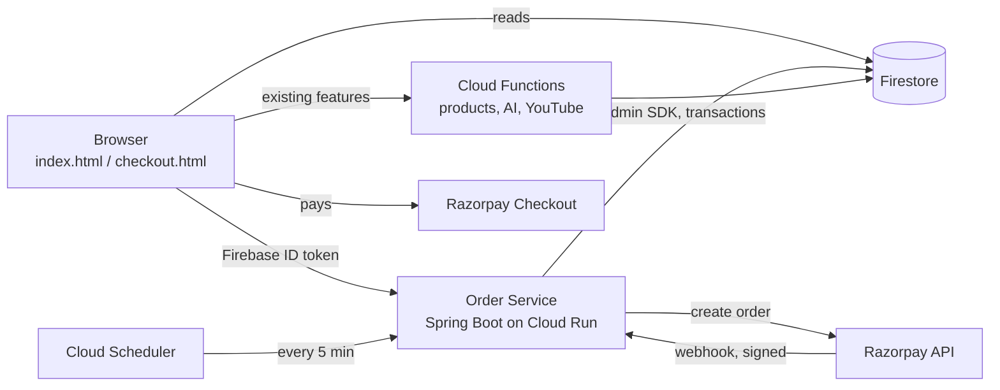
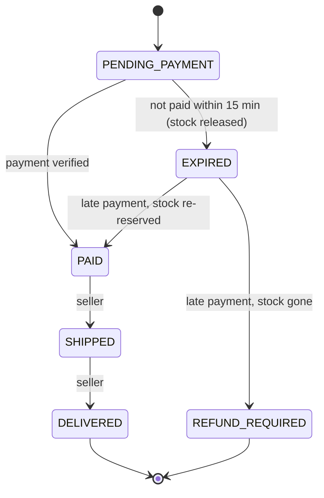

# Kalasetu Order Service: Design

## 1. Context

Kalasetu's checkout originally wrote orders to Firestore directly from the browser, with the total calculated client-side and no payment step. That works for a demo, but a real marketplace needs:

- **Price integrity**: the amount charged must come from the server, never from the client.
- **Real payments**: buyers pay through a payment gateway (Razorpay, test mode).
- **No double charging**: a retried request or a double-clicked button must not create two orders.
- **Stock safety**: two buyers must not both buy the last unit.
- **A clear order lifecycle** that artisans can act on (ship, deliver).

The order service is a separate Spring Boot application that owns everything about orders and payments. The rest of Kalasetu (marketplace, AI tools, community, Cloud Functions) is unchanged.

### Non-goals (for now)

- Refund automation (flagged orders are handled manually).
- Multi-currency (INR only).
- Seller payouts to bank accounts (the ledger records what each seller is owed; settlement is out of scope).

## 2. Architecture



- **Firebase Auth** stays the identity provider. The service verifies the Firebase ID token on every request, so no second login system exists.
- **Firestore** stays the database. The service uses the Admin SDK, so it is not subject to client security rules and is the only writer of orders once deployed.
- **Cloud Run** runs the container: scales to zero when idle, no servers to manage.
- **Cloud Scheduler** triggers the expiry job. Cloud Run instances can be shut down at any time, so in-process timers are not reliable.

## 3. Payment flow

```mermaid
sequenceDiagram
    participant U as Browser
    participant S as Order Service
    participant F as Firestore
    participant R as Razorpay

    U->>S: POST /api/v1/orders (items, shipping, Idempotency-Key)
    S->>F: transaction: read products, check + reserve stock,<br/>write order (PENDING_PAYMENT), write idempotency record
    S->>R: create Razorpay order (amount in paise, receipt = orderId)
    S->>F: save gateway order id
    S-->>U: orderId, gatewayOrderId, amount, keyId
    U->>R: Razorpay Checkout (buyer pays)
    R-->>U: paymentId, signature
    U->>S: POST /api/v1/orders/{id}/payment (paymentId, signature)
    S->>S: verify HMAC signature
    S->>F: transaction: PENDING_PAYMENT -> PAID, write ledger entries
    S-->>U: order (PAID)
    R->>S: webhook payment.captured (signed)
    S->>F: dedupe by event id; already PAID -> no-op
```

The browser callback and the webhook both confirm payment. Whichever arrives first marks the order `PAID`; the second is a no-op. The webhook covers the case where the buyer pays and then closes the tab before the callback reaches the service.

## 4. Order state machine



Transitions are defined in one place (`OrderStatus`) and every status change goes through it, so an invalid transition (for example `DELIVERED -> PAID`) is rejected rather than silently written. Each change is appended to `statusHistory` with a timestamp and actor.

A failed payment attempt does **not** end the order: Razorpay lets the buyer retry on the same gateway order, so the order stays `PENDING_PAYMENT` until it is paid or expires.

## 5. Data model

All amounts are stored as **integers in paise** (`long`). Floating-point rupees cause rounding errors (`0.1 + 0.2 != 0.3`), so prices are converted once, with `BigDecimal`, when the order is created.

**`products/{productId}`** (existing collection, one optional field added)

| Field | Type | Notes |
|---|---|---|
| `stock` | number, optional | Units available. **If absent, stock is not tracked**, so every existing product keeps working unchanged. |

**`orders/{orderId}`** (written only by the service)

| Field | Type | Notes |
|---|---|---|
| `buyerId` | string | Firebase uid |
| `items` | array | `{productId, sellerId, name, unitPricePaise, quantity, lineTotalPaise}`, prices copied at purchase time |
| `sellerIds` | array of string | Lets a seller query their orders with `array-contains` |
| `totalPaise` | number | Sum of line totals, calculated on the server |
| `currency` | string | `INR` |
| `shipping` | map | `{name, email, address}` |
| `status` | string | See state machine |
| `gatewayOrderId`, `gatewayPaymentId` | string | Razorpay ids |
| `statusHistory` | array | `{status, at, actor}` |
| `createdAt`, `updatedAt`, `expiresAt` | timestamp | |

**`idempotencyKeys/{sha256(uid + ":" + key)}`**: `{requestHash, orderId, createdAt}`

**`webhookEvents/{eventId}`**: `{type, processedAt}` (dedupes webhook retries)

**`ledgerEntries/{auto}`**: `{orderId, sellerId, amountPaise, type, createdAt}`. One `SELLER_CREDIT` entry per seller per paid order. Entries are only ever added, never edited; a correction would be a new entry. A seller's balance is the sum of their entries.

Indexes: `orders(buyerId, createdAt desc)`, `orders(sellerIds array-contains, createdAt desc)`, `orders(status, expiresAt)`.

## 6. API

All endpoints except the webhook and the job require `Authorization: Bearer <Firebase ID token>`.

| Method | Path | Who | Purpose |
|---|---|---|---|
| `POST` | `/api/v1/orders` | buyer | Create order. Requires `Idempotency-Key` header. |
| `GET` | `/api/v1/orders/{id}` | buyer or seller on the order | Fetch one order |
| `GET` | `/api/v1/orders?role=buyer\|seller` | any user | List own purchases, or orders for own products |
| `POST` | `/api/v1/orders/{id}/payment` | buyer | Confirm payment with Razorpay signature |
| `PATCH` | `/api/v1/orders/{id}/status` | seller on the order | `SHIPPED` or `DELIVERED` |
| `POST` | `/api/v1/webhooks/razorpay` | Razorpay | Signed with `X-Razorpay-Signature` |
| `POST` | `/internal/jobs/expire-orders` | Cloud Scheduler | Shared-secret header `X-Job-Token` |

Errors use RFC 7807 problem details (`application/problem+json`) with a stable `code` field, for example `OUT_OF_STOCK`, `IDEMPOTENCY_KEY_REUSED`, `INVALID_STATUS_TRANSITION`.

**Create order request**

```json
{
  "items": [{ "productId": "abc123", "quantity": 2 }],
  "shipping": { "name": "Asha", "email": "asha@example.com", "address": "12 MG Road, Bengaluru" }
}
```

**Create order response** (`201 Created`, or `200 OK` when replayed with the same key)

```json
{
  "orderId": "xyz789",
  "status": "PENDING_PAYMENT",
  "totalPaise": 240000,
  "currency": "INR",
  "gatewayOrderId": "order_Nx...",
  "gatewayKeyId": "rzp_test_...",
  "expiresAt": "2026-10-17T11:15:00Z"
}
```

## 7. Correctness

**Price integrity.** The request carries only product ids and quantities. Prices are read from Firestore inside the transaction that creates the order.

**Idempotency.** The client generates one key per checkout attempt and reuses it on retry. The key record and the order are written in the same transaction, so either both exist or neither does.
- Same key, same request → the existing order is returned (`200`).
- Same key, different request (different hash of items and shipping) → `422 IDEMPOTENCY_KEY_REUSED`.
- Keys are scoped per user, so one user cannot replay another user's key.

**Concurrent stock.** Firestore transactions are serializable. The server SDK locks every document a transaction reads until it commits, and a transaction that loses a conflict is retried with fresh data. Two buyers racing for the last unit therefore cannot both succeed; the second sees `stock = 0` and fails with `OUT_OF_STOCK`. The test suite runs 16 concurrent buyers against one unit and checks that exactly one order is created.

**Gateway call outside the transaction.** Firestore transactions may be retried, so they must not have side effects. The Razorpay order is created after the transaction commits. If that call fails, the order stays `PENDING_PAYMENT` without a gateway id; a retry with the same idempotency key finds it and creates the gateway order then. Razorpay's `receipt` is set to our order id, which ties the two together.

**Signature verification.** Both checks use HMAC-SHA256 and a constant-time comparison:
- Checkout callback: HMAC of `gatewayOrderId|paymentId` with the key secret.
- Webhook: HMAC of the raw request body with the webhook secret.

The service also checks that the payment belongs to the order's own `gatewayOrderId`, so a valid signature for a different order is rejected.

**Webhook retries.** Razorpay retries webhooks until it gets a `2xx`. Each event id is recorded in the same transaction as its effect, so a repeated event has no effect.

**Late payment after expiry.** The Checkout widget is given a 10-minute timeout while reservations last 15 minutes, so this should be rare. If it happens anyway, the service tries to re-reserve stock: on success the order becomes `PAID`; otherwise it becomes `REFUND_REQUIRED` and an error is logged for follow-up. Money is never silently accepted for stock that does not exist.

## 8. Failure cases

| Failure | Result |
|---|---|
| Client retries `POST /orders` after a timeout | Same order returned (idempotency) |
| Razorpay API down when creating order | `503`; order kept; retry with same key completes it |
| Buyer pays, closes tab before callback | Webhook marks order `PAID` |
| Callback and webhook arrive together | Transaction makes one succeed; the other sees `PAID` and returns it |
| Webhook delivered twice | Second is ignored (event id recorded) |
| Forged payment callback | Signature check fails → `400` |
| Buyer never pays | Expiry job releases stock after 15 min |
| Expiry job misses a run | Next run catches up (queries all expired, not just the last 5 min) |
| Service instance crashes mid-request | Firestore transaction either committed or not; idempotent retry is safe |

## 9. Security

- Every user-facing request is authenticated with a verified Firebase ID token; the uid comes from the token, never the request body.
- Buyers see only their orders; sellers see only orders containing their products and can only move them forward.
- Secrets (Razorpay keys, webhook secret, job token) come from environment variables backed by Secret Manager, never from the repo.
- CORS allows only the Kalasetu Hosting domains.
- Once the service is live, Firestore rules for `orders`, `ledgerEntries`, `idempotencyKeys` and `webhookEvents` should deny client writes (see `order-service/README.md`).

## 10. Backward compatibility

- `checkout.js` uses the service only when `ORDER_SERVICE_URL` is configured. Without it, the original checkout flow runs exactly as before, so the live site keeps working until the service is deployed.
- Products without a `stock` field are treated as untracked stock.
- Orders created by the original flow (status `placed`, rupee `total`) stay in Firestore untouched.

## 11. Scaling

At current traffic one Cloud Run instance is plenty. What changes at 100×:

- **Hot products.** A Firestore document sustains roughly one write per second. A viral product with stock tracking becomes a bottleneck; the fix is sharded stock counters (split stock across N sub-documents and reserve from a random shard).
- **Expiry job.** Query by `status` and `expiresAt` in pages of a few hundred instead of loading all expired orders.
- **Webhook spikes.** Acknowledge immediately and process through Pub/Sub so slow Firestore writes never cause Razorpay timeouts and retries.
- **Seller dashboards.** Maintain per-seller summary documents updated on payment instead of summing ledger entries on every view.

## 12. Testing

- Unit tests: state machine transitions, rupee-to-paise conversion, both signature checks, request hashing.
- Service tests against an in-memory store: idempotent replay, key reuse, out-of-stock, concurrent buyers for the last unit, late payment after expiry, duplicate webhooks.
- Web layer tests: authentication required, validation errors, problem-details format.
